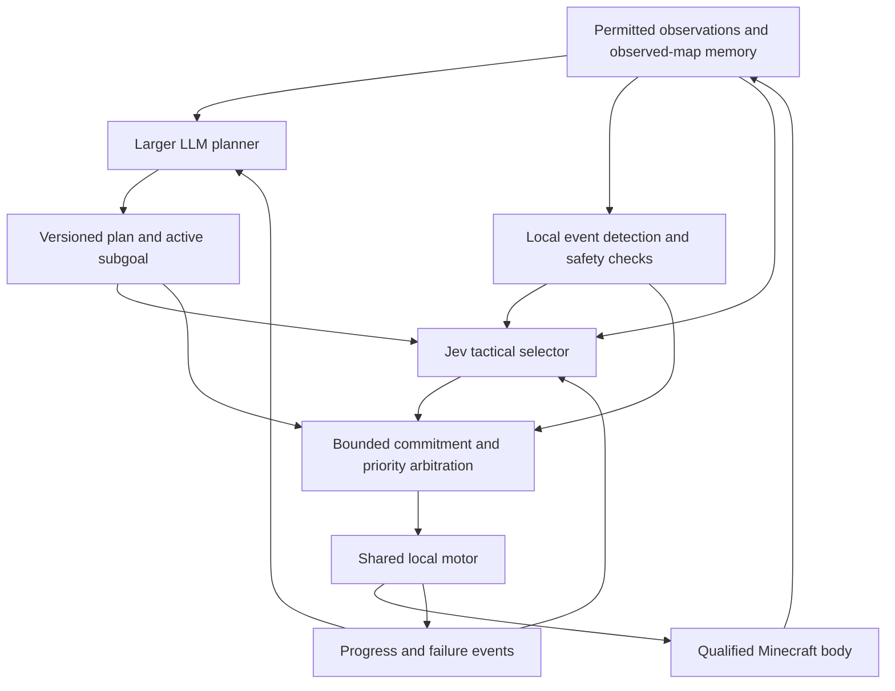

# Hybrid planning, tactical decisions and motor control

> **Partly superseded (Oct 28, 2026):** Jev choosing local waypoints or behaviors inside the motor loop is legacy. Jev now sets goals, cost profiles and tactical interrupts; the plan/commitment, priority and interrupt/resume rules below still apply. See [NAVIGATION_DIRECTION_2026-10-28.md](NAVIGATION_DIRECTION_2026-10-28.md).

October 25, 2026. Candidate hypothesis: a larger LLM supplies planning context and
a faster model such as Jev handles tactical choices and interruptions. Marc
explicitly clarified that this is a hypothesis to test, not the chosen winner.
The harness must support single-model and tandem conditions, configurable model
assignments, and evidence that can favor either condition. The architecture below
describes the tandem candidate; it does not prescribe the final architecture.

## Roles and authority

| Layer | Responsibility | Output | Execution cadence |
| --- | --- | --- | --- |
| Larger LLM planner | Interpret the task, choose subgoals, decide priorities and resource/risk budgets, revise an unsuccessful plan | Versioned structured plan with an active subgoal, completion condition, constraints and interruption policy | Asynchronous, on task changes, subgoal completion, material new information or failed progress |
| Jev tactical selector | Decide whether to continue, pause for a useful observed item, respond to a threat, resume, or request replanning; choose bounded local behaviors within the active subgoal | Typed Choice referring to the current plan/subgoal revision and offered observation-derived candidates | Event-driven; initially at most 2 requests/second, one outstanding tactical request/body, original 1-second deadline |
| Local motor and safety controller | Follow bounded local paths, turn, jump, aim/mine within qualified capabilities, and reject stale or unsafe controls | Tick-bound primitive controls and execution/failure events | Local tick loop; existing fresh-observation and action timing checks apply |

The planner does not send raw button commands. Jev does not repeatedly reconstruct
the entire strategic plan. The motor does not secretly choose the next strategic
task or rescue a bad selector decision by completing the course itself.

## Plans and tactical commitments remain separate objects

Each plan carries a plan ID/revision, parent task, active subgoal ID, explicit
success/abandon conditions, permitted behaviors, risk limits, optional pickup
budget and expiry/replanning policy. A proposed plan must be schema validated and
bound to the current run/body before becoming active. A late proposal cannot
overwrite a newer plan or a subgoal already completed while it was thinking.

Each tactical request carries the active plan/subgoal revision, reason for the
request, observation tick and permitted compact facts. Candidate IDs identify
bounded behaviors/local goals; no full-course solution primitive is offered.
A response is a short-lived commitment, not a replacement strategic plan.
Recheck plan revision, goal validity, observations, preconditions and timing
before admission and during every motor renewal. A response to an older plan is
discarded even when its network deadline was met.

Keep planner generation numbers, tactical decision IDs and native motor action
IDs distinct. Record their relationship rather than overloading one field.
Planner and tactical calls have separate budgets, deadlines and cancellation
state; slow planning cannot occupy the tactical request slot.

## Interruptions, priorities and resumption

Priority order:

1. Explicit cancellation, expired controls and immediate physical safety checks.
2. A qualified immediate threat response selected within the permitted profile.
3. A bounded opportunistic diversion allowed by the planner's current policy.
4. Progress toward the active strategic subgoal.

An emergency invalidates the old motor commitment immediately. The local safety
layer must not wait for a remote model before releasing a now-unsafe command.
Hosted Jev's recent C1 median was approximately 312 ms; its deadline is one second.
Those observations do not establish a suitable combat reaction time or guarantee
that damage can be prevented. Safety is a separate local responsibility.

Jev decides the tactical response from current permitted facts and qualified
actions while a slow planner call may still be in flight. If an older tactical
request is outstanding, invalidate its context and coalesce the new event rather
than start concurrent tactical calls or admit its stale answer. Immediate local
safety handling remains available while that request finishes or times out.

An opportunistic pickup suspends the current subgoal without deleting its plan.
Jev receives the observed item's relevance, known local approach facts and the
planner's diversion constraints. A diversion has a bounded time/distance/resource
budget and explicit completion, cancellation and failure conditions. Its
commitment cannot silently grow into an unrestricted goto-item behavior.

On completion or expiry, revalidate the suspended subgoal and its plan revision
before resuming. A changed threat, blocked route, exhausted budget or invalid
goal can request replanning. Add cooldowns and event deduplication so repeated
observations of the same drop or damage event do not cause request storms,
oscillation or repeated plan suspension. Repeated critical events may supersede
lower-priority commitments; an opportunity cannot suppress a threat response.

The first milestone must exercise an observed pickup interruption and resumption
without requiring a fresh large-LLM call for every tactical decision.

## What each layer may observe

All layers use permitted observations and tick-indexed memory of previously
observed facts. Separate current visibility from remembered geometry and include
fact ages. Neither planner nor Jev receives privileged course/seed/specification
metadata, hidden target coordinates, evaluator solutions or expected labels.
Planner summaries may cover more observed history but never reveal hidden state.

Local event detection may report a visible item, an inventory change, lack of
progress or an observed health/threat change when supported by the sensor profile.
Detection does not infer an unseen attacker's identity, position or intent.
The original sensor's 360-degree local visibility remains explicitly declared;
this is not a camera-only or human-equivalent perception claim.

## Implementation sequence and experimental controls

1. Implement versioned plan/subgoal, event, tactical request and commitment
   contracts, plus priority arbitration, cancellation and resume/replan behavior.
   Use deterministic fake providers first to exercise interleavings without
   changing the qualified body or spending provider budget.
2. Connect separate planner and Jev backend instances to the shared motor.
   Keep initial planner objectives as explicit test inputs while validating the
   tactical integration; label that condition as a scripted planner, not an LLM.
   Then add the larger LLM through its own validated structured-plan adapter.
   The endpoint/model remains configurable; do not reconfigure shared Atom or
   claim that its existing tactical route is an independently tested planner.
3. Freeze actual recorded navigation and interruption states. Review valid
   responses from geometry and declared policy, then screen Jev under candidate
   order changes. Test late plans, stale tactical responses, conflicting events,
   unavailable backends and both provider budgets before native trials.
4. Run bounded native C2–C5 smoke variants with observed pickup interruptions and
   measured resumption. Compare identical motors and action profiles. Keep
   scripted-planner, larger-LLM-planner and Jev-enabled conditions separately named.
5. Freeze and audit paired development comparisons. Report task completion,
   interruption/resumption success, threat reaction timing where qualified,
   stuck/fall behavior, planner calls, tactical calls, stale responses, decision
   switching, observation-to-action latency and reported/settled provider costs.

Useful comparisons are a deterministic selector with the common motor, a planner
with fixed tactical rules, and the same planner plus Jev. Change one component at
a time where making a component claim. Historical V8 is a separately identified
whole-system reference, not automatically an identical-motor baseline.

## Capability and qualification boundaries

Initial implementation exercises planning, navigation, pickup decisions and
interrupt/resume coordination. Entity attacks and combat knockback are pending
extensions in `docs/gates.json`. Define threat-event hooks now, but do not enable
or advertise live fighting until body/sensor/action evidence qualifies it.
Controller-only injected threat events test arbitration; they are not native
combat evidence. Any Java/body/source change needs the relevant regressions.

The hybrid architecture is not proof of learned motor competence. Synchronized
human demonstrations, compact motor-policy training, construction, camera/vision
and fresh holdouts remain separately scoped later work. Existing legal/scoring,
physics, timing and source-bound admission checks remain in force.

## Implemented harness support

`TandemController` is an optional C1 controller alongside the original
`TacticalController`. Planner and tactical models use separate backend instances,
deadlines, request slots and caps. Slow planning does not block tactical calls or
motor updates. Versioned planner context is added to tactical requests; expired
plans and obsolete tactical replies are discarded, and both roles' exchanges,
request totals and provenance remain recorded through shutdown failures.

The initial planner adapter selects among explicitly configured strategy choices.
It is a bounded Choice-planner experiment, not the unrestricted structured-plan
brain proposed above. The default on planner failure is to fail the attempt;
`continue_without_plan` is an explicit recorded degraded condition. General
opportunity suspension/resumption and native combat handling remain future work.

The existing `models live-smoke --backend ...` remains single-model. Add
`--planner-backend`, `--planner-profile` and `--planner-request-limit` to opt into
tandem mode. Both role caps and their combined conservative remote cost budget
are validated before world access. No model or role assignment is automatically
selected. See the README for the profile schema and example commands.

Local fake-provider tests exercise overlapping lanes, stale context, expiry,
failure/redaction, cancellation and per-role accounting. No new two-model live
Minecraft success or superiority claim follows from these integration tests.
See `JEV_NAVIGATION_PLAN.md` for the continuing experiment plan.
